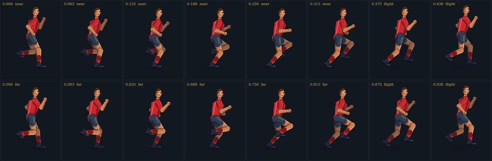

# RunLab — a procedurally generated running sprite

A TypeScript study in two halves: **forensics on a bad sprite sheet**, and a **running character generated
from a skeleton and a gait model** that fixes what the sheet gets wrong. The web app plays the generated
runner live and lets you change the biomechanics while it runs.



Both personas are rendered by the same rig: `reports/filmstrip-sg-chinese-male.png` and
`reports/filmstrip-sg-chinese-female.png`.

## The six deliverables

| # | Deliverable | Where | Result |
| --- | --- | --- | --- |
| 1 | Dedupe the art so every file is unique | `npm run images:dedupe` | **0 byte-identical files**. The real duplication is *inside* the sheet: 48 frames, only **4 distinct poses per row** (reported per row). |
| 2 | File the art into `src/images` with meaningful names | `src/images/source/` | `runner-sheet__8frame-alternating-gait__6-colorways__source.jpeg` — content, layout and role in the name |
| 3 | Extract the small pieces to a public URL path | `npm run sprites:extract` → `public/sprites/` | 48 registered frames + 48 tight cut-outs at `/sprites/reference/<colourway>/frame-NN.png`, plus `manifest.json` and a contact sheet |
| 4 | Assess the flaw in the animation | [`docs/sprite-flaw-analysis.md`](docs/sprite-flaw-analysis.md) | Seven measured findings; the headline is **4 poses repeated, not 8**, and **2 of 8 frames on the ground** |
| 5 | Generate the body and articulating parts algorithmically | `src/lib/rig/`, `src/lib/gait/` | 9 parts from capsules and profiles; analytic two-bone IK; periodic pelvis curve; continuous phase, no key poses |
| 6 | TypeScript web app with full running motion | `src/app/` | Live canvas, two personas, six gait controls, six palettes, rig overlay, footprint trail, live metrics, flaw panel and extracted-frame strip |

## What the pipeline does

```
source JPEG
   │  detectSheet()        find 6×8 figures from artwork alone (no title parsing)
   │  cutCell()            chroma key + nearest-colour unmixing, per-figure mask
   │  registerSprites()    translate-only alignment on the pelvis
   ▼
public/sprites/reference/<colourway>/frame-NN.png   (223×244 shared canvas)
public/sprites/manifest.json                        (pivots, metrics, poses, duplicates)
```

Keying is the interesting part: JPEG smears the magenta field into every edge, so a hue key leaves a pink
rim. Edge pixels take the colour of the nearest solid art pixel and their alpha is recovered by projecting
the blended colour onto the art→key line. The result is **0 opaque magenta pixels** and **< 0.2 %**
magenta-hued edge pixels, against **40.7 %** for a naive key.

## What the generator does

```
controls ──► resolveGait() ──► sampleLeg() × 2 ──► solvePose() ──► composeRunner() ──► paintScene()
             (timing)          (foot paths)        (IK + FK)        (grouped polygons)   (canvas)
```

- **Timing**: cadence, stride, duty factor. Stance is a straight ground track at exactly the ground speed;
  swing is a cubic Bézier with a heel kick and a knee-drive apex.
- **Pose**: analytic two-bone IK with the knee always on the forward side of the hip–ankle line; arms
  oppose legs from a vertical shoulder line; the pelvis follows a periodic curve through contact,
  mid-stance, toe-off and mid-flight.
- **Articulation**: the torso stops at the neck base; the **neck is its own segment** and the head has its
  own stabiliser, so the gaze stays level while the trunk leans. The **foot is split at the ball**:
  `plantFoot()` keeps the lowest sole point on the ground while the heel peels and the toe pushes.
- **Falling forwards**: `lean` pitches the trunk about the hip and shifts the stance track back, so the
  support foot trails the pelvis — the runner is always catching himself.
- **Foot roll**: `npm run runner:footroll` prints the sole gap under the heel, ball and toe for eight
  stance phases, so the roll is measurable frame by frame
  ([`reports/foot-roll-sg-chinese-male.png`](reports/foot-roll-sg-chinese-male.png)).
- **Body**: nine parts, each a set of polygons in its own joint frame — torso, neck, head, thigh, shin,
  shoe, shoe-toe, upper arm, forearm/fist. Far-side parts are shaded and drawn first.
- **Personas and skins**: anatomy (`BodyMetrics`) is separate from presentation (`Skin`: palette, hair
  silhouette, optional per-part `PartBuilder` overrides). Two personas ship — Singaporean Chinese male
  and female — and the app toggles between them at runtime.
- **Rendering**: each part is stroked once at 1.15× then filled, so the fills hide the inner half of the
  stroke and every part keeps one clean silhouette edge. No bitmap art is used.

## Quick start

```bash
npm install
npm run dev        # http://localhost:3000  (binds 0.0.0.0, preview-proxy safe)
```

| Command | What it does |
| --- | --- |
| `npm run dev` | Vite dev server on `0.0.0.0:3000` |
| `npm run validate` | typecheck → 114 tests → production build (the merge gate) |
| `npm test` | Vitest suites only |
| `npm run sprites:extract` | re-cut the sheet into `public/sprites/` |
| `npm run sprites:analyse` | re-measure both cycles into `src/generated/` and `reports/` |
| `npm run images:dedupe` | byte-level and silhouette-level duplicate report |
| `npm run runner:preview -- sg-chinese-male red` | render the 8-phase contact sheet |
| `npm run runner:filmstrip -- sg-chinese-female` | render the 16-phase strip |

## Layout

```
src/images/source/   the source artwork
src/lib/geometry/    vectors, polygons, capsules
src/lib/rig/         body metrics, nine parts, palettes, personas/skins
src/lib/gait/        timing, foot paths, foot roll, IK, pose model
src/lib/render/      scene graph + canvas painter
src/lib/pipeline/    sheet detection, keying, cut-out, registration, PNG
src/lib/analysis/    cycle measurements shared by tests and UI
src/app/             store, loop, components, view, styles
src/generated/       analysis JSON consumed by the app
public/sprites/      generated cut-outs, served at /sprites/...
docs/                flaw analysis, addenda register, greenfield provenance
```

## Working agreement

This repository follows the **GREENFIELD** discipline from
[`wshyang/greenfield`](https://github.com/wshyang/greenfield). Start at [`CLAUDE.md`](CLAUDE.md); every
non-obvious decision is recorded in [`docs/ADDENDA.md`](docs/ADDENDA.md).

## Validation status

Verified: typecheck clean, **114 tests passing**, production build clean, the pipeline ran against the real
2 528×1 696 JPEG, and every preview image in `reports/` was rasterised with a real canvas.

Not verified: **the UI was not opened in a browser** — the build sandbox has no Chrome and cannot install
`libnss3`. The preview should be opened once by a human before shipping the screenshot.
